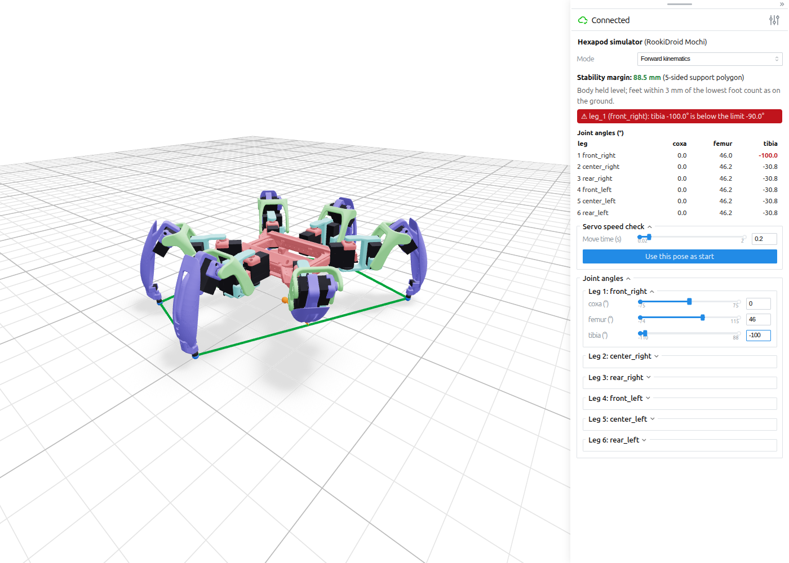
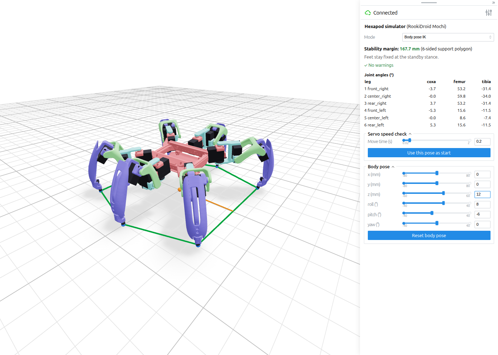
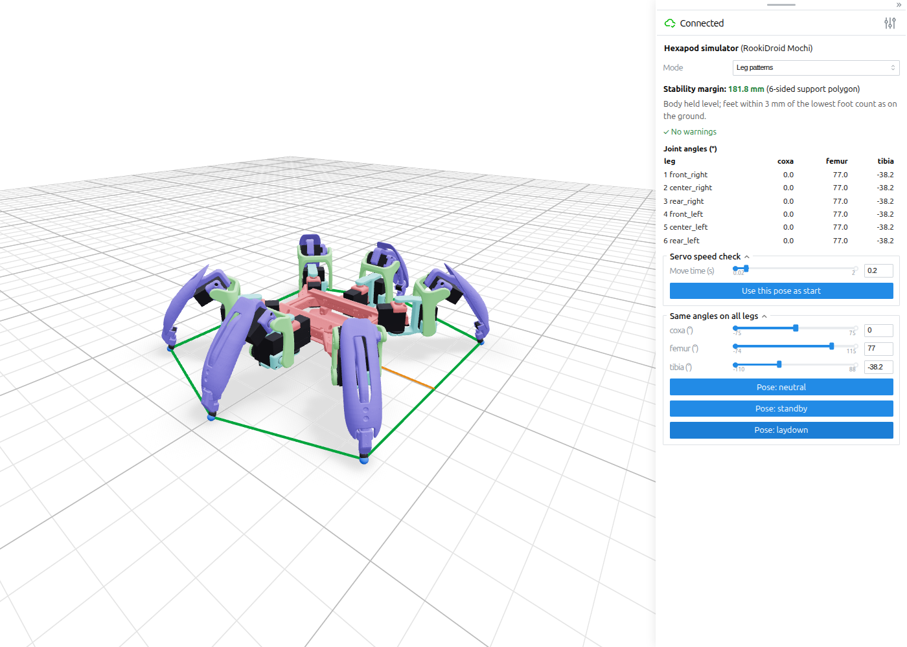
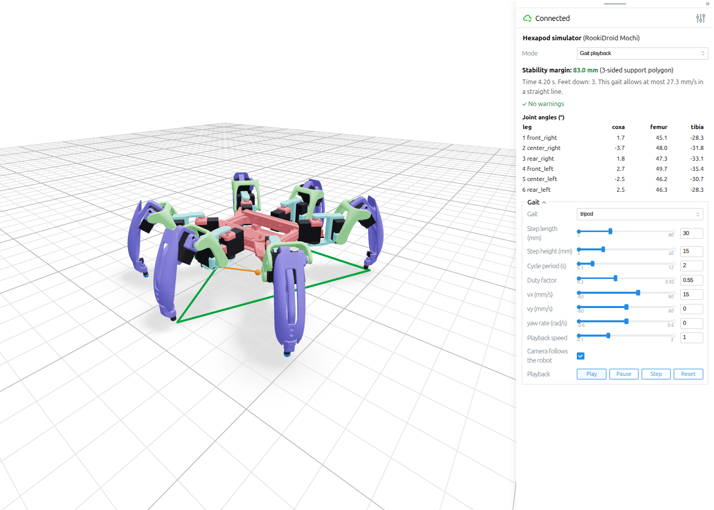
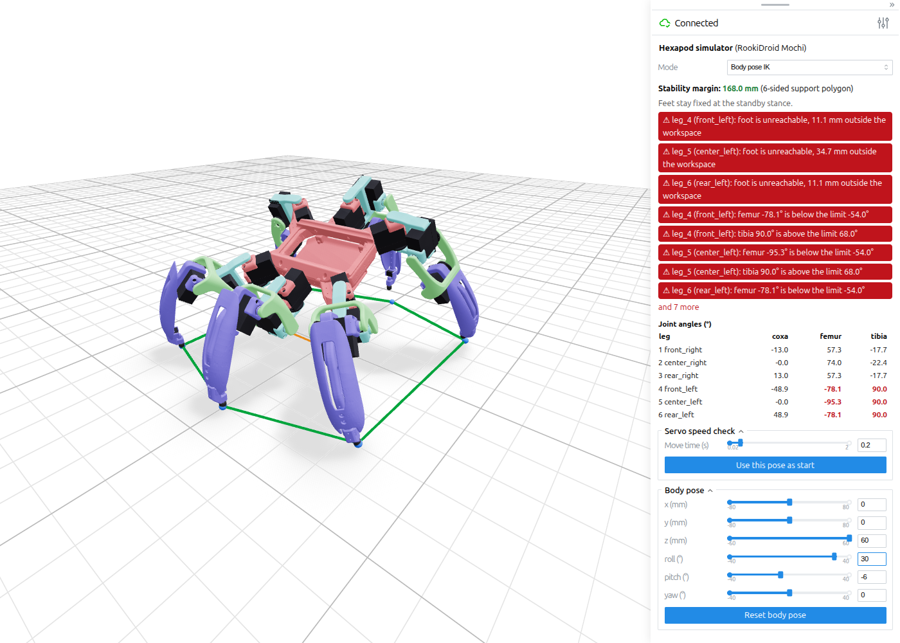
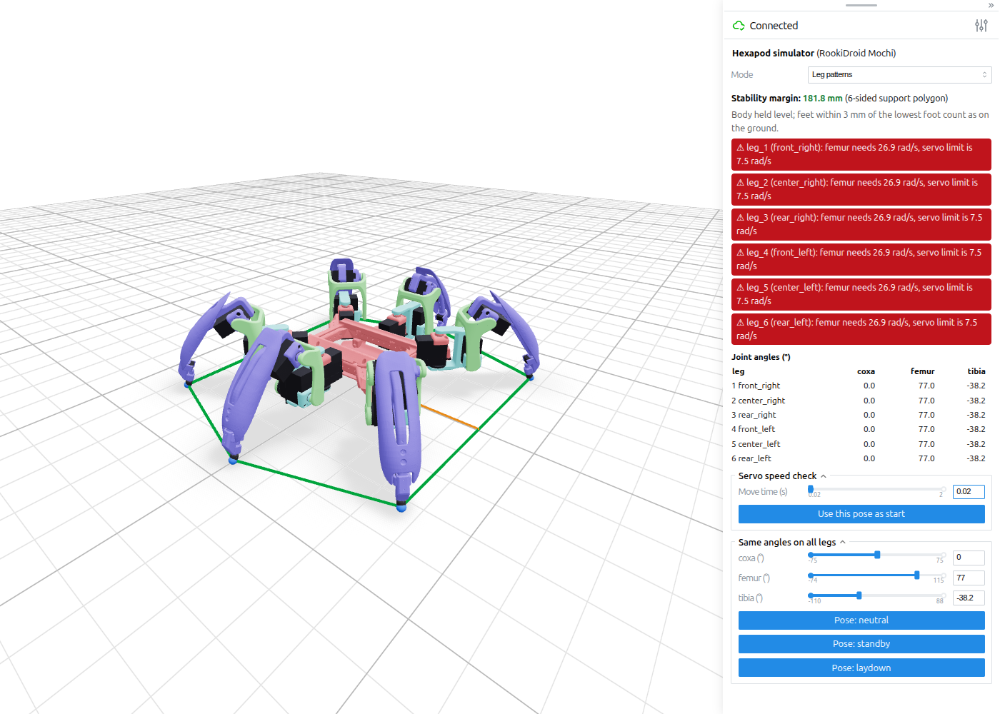
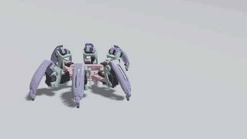

# Hexapod workspace

ROS 2 Jazzy description of an 18-DOF hexapod with MG996R servos, an ESP32 with 2 x PCA9685, and a Raspberry Pi 5. It is the shared robot model for a classical kinematics controller and a reinforcement learning policy. The previous robot, a RookiDroid Mochi, is at git tag `mochi-v1`.

## Model sources

The robot is the [MakeYourPet hexapod](https://github.com/MakeYourPet/hexapod), Copyright (c) 2022 MakeYourPet.com, MIT licence (commit `7d8fc80`). It uses the part selection of the [Robot Lk guide](https://robotlk.com/build-your-own-18dof-hexapod-robot/): the 60 mm Chipo coxa and femur with the long main tibia and shield. The meshes in `src/hexapod_description/meshes/makeyourpet/` derive from those parts, and that folder includes the licence.

These stay out of git, with anything derived from them:

- `refs/emre_hexapod/`: the Robot Lk zip, used only for comparison, and any MakerWorld files (personal use only, no redistribution, including remixes).
- `refs/mg996r/`: an MG996R model from a GrabCAD user upload, licence unclear. Until it's added, servos are our own placeholder boxes.

## Build and run

Needs Ubuntu 24.04, ROS 2 Jazzy and Gazebo Harmonic. [`scripts/install_deps.sh`](scripts/install_deps.sh) installs them.

```bash
cd ~/hexapod_ws
source /opt/ros/jazzy/setup.bash
colcon build --symlink-install
source install/setup.bash
ros2 launch hexapod_description display.launch.py
```

This opens RViz and a slider for each joint. Use `gui:=false` to drive `/joint_states` from another node.

## Simulator

A browser simulator with four modes: forward kinematics, body pose IK, leg patterns and gait playback. It needs no ROS. One-time setup:

```bash
python3 -m venv .venv
.venv/bin/pip install -e src/hexapod_kinematics -e src/hexapod_sim
```

Then run it and open http://localhost:8080:

```bash
.venv/bin/python -m hexapod_sim
```

It listens on this machine only. Add `--host 0.0.0.0` to allow other machines, and `--port` to change the port.

| Forward kinematics | Body pose IK |
|---|---|
|  |  |

| Leg patterns | Gait playback |
|---|---|
|  |  |

| Unreachable feet and limits | Servo speed |
|---|---|
|  |  |

## Kinematics library

[`hexapod_kinematics`](src/hexapod_kinematics) is pure Python with numpy and PyYAML, and has no ROS imports. It reads all robot values from `robot_parameters.yaml`. The maths and gait parameters are in [`docs/kinematics.md`](docs/kinematics.md).

```python
from hexapod_kinematics import RobotModel, GaitParams, VelocityCommand, generate_gait, body_pose_ik, write_csv

model = RobotModel.load()
pose = body_pose_ik(model, translation=(0.01, 0, 0), rpy=(0, 0.05, 0))
print(pose.q, pose.issues)

gait = generate_gait(model, GaitParams(gait='tripod'), VelocityCommand(vx=0.015))
print(gait.summary())
write_csv(model, gait, 'tripod.csv')
```

To export a gait from the command line:

```bash
.venv/bin/python -m hexapod_kinematics --gait ripple --vx 0.01 --cycles 3 -o ripple.csv
```

The CSV has time, 18 joint angles, world-frame foot positions, foot contacts, body pose and stability margin, in SI units and radians.

## Gazebo simulation



The robot walks in Gazebo Harmonic through one command path: `/joint_commands` -> servo model controller -> joint efforts. The classical controller in `hexapod_controller` reads no ground truth. Its gait parameters are in [`controller.yaml`](src/hexapod_controller/config/controller.yaml).

```bash
source /opt/ros/jazzy/setup.bash
colcon build --symlink-install
source install/setup.bash

ros2 launch hexapod_controller walk.launch.py                # add gui:=false for headless
ros2 launch hexapod_controller teleop.launch.py              # in another terminal, or joystick:=true for a gamepad
```

To measure a run or record a GIF:

```bash
ros2 run hexapod_gazebo run_scenario.py --vx 0.05 --seconds 30 --set step_height=0.03    # prints a metrics table, writes runs/
ros2 launch hexapod_controller walk.launch.py gui:=false camera:=true                    # then, in another terminal:
ros2 run hexapod_gazebo record_gif.py walk.gif
```

The launch test stands the robot up, walks 1 m, turns 90 degrees, then walks for 60 s:

```bash
launch_test src/hexapod_gazebo/test/test_walking.launch.py
```

Result on the flat world with the tripod gait at the default parameters:

| Check | Result |
|---|---|
| Stand | Reached at sim t=4.45 s, body height 80.7 mm |
| Walk 1 m at 0.05 m/s | True speed 0.0460 m/s (8.0% low), lateral drift -2.7 mm |
| Turn, 90 degrees commanded | 87.4 degrees |
| 60 s walk | No fall, 0 violations, at least 3 foot switches pressed, real-time factor 0.99 |
| `/joint_commands` | 50.0 Hz, 18 values |

Not verified yet: see [`docs/TODO.md`](docs/TODO.md).

## Tests

```bash
.venv/bin/pip install pytest
.venv/bin/python -m pytest src/hexapod_kinematics src/hexapod_sim

# Operate the real UI in headless Chrome and refresh docs/images (needs Google Chrome):
.venv/bin/pip install playwright
.venv/bin/python scripts/capture_sim_screenshots.py
```

Run these in a shell without ROS sourced. Under ROS, the C++ and foot switch tests run with `ctest -E test_walking` in `build/hexapod_gazebo`, and the controller tests with:

```bash
PYTEST_DISABLE_PLUGIN_AUTOLOAD=1 PYTHONPATH=src/hexapod_kinematics:$PYTHONPATH python3 -m pytest src/hexapod_controller/test/test_core.py
```

`colcon` does not build `hexapod_kinematics` or `hexapod_sim`, because they are plain Python packages. Under ROS, make the library importable with `export PYTHONPATH=$HOME/hexapod_ws/src/hexapod_kinematics:$PYTHONPATH`.

## Check the model

```bash
xacro src/hexapod_description/urdf/hexapod.urdf.xacro > /tmp/hexapod.urdf && check_urdf /tmp/hexapod.urdf

# All 18 joints: run the launch with gui:=false rviz:=false in another terminal, then:
python3 scripts/verify_joints.py
```

## Regenerate meshes and parameters

`refs/` is not tracked.

```bash
git clone https://github.com/MakeYourPet/hexapod refs/makeyourpet_hexapod
git -C refs/makeyourpet_hexapod checkout 7d8fc80
python3 -m venv .venv && .venv/bin/pip install -r scripts/requirements.txt -e src/hexapod_kinematics -e src/hexapod_sim

.venv/bin/python scripts/generate_model.py            # write the meshes and the YAML
.venv/bin/python scripts/measure_geometry.py          # compare the model with the STLs
.venv/bin/python scripts/sweep_limits.py              # joint limits from mesh contact
.venv/bin/python scripts/calibrate_leg_collision.py   # refit leg collision capsules
.venv/bin/python scripts/check_bays.py                # do the electronics fit?
.venv/bin/python scripts/power_budget.py              # torque margin, regulators, battery
```

`generate_model.py` overwrites the YAML, so change values in the script rather than in the YAML. Limits from the sweep and the capsule radii are entered in the script by hand.

## Licence

Our code is GPL-3.0. The meshes in `meshes/makeyourpet/` are MIT, from MakeYourPet: see the `LICENSE` file there.
